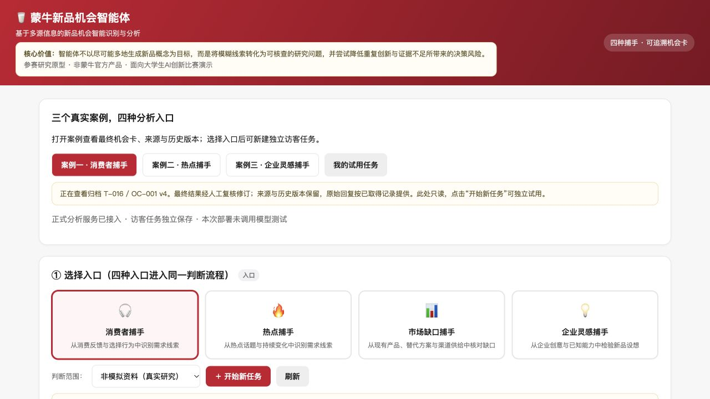

# Chance｜蒙牛新品机会智能体

面向大学生 AI 创新比赛的研究原型，将消费者反馈、热点、市场供给和团队创意汇入同一套机会识别流程。

**[在线体验](https://mengniu-opportunity.coze.site/)** · **[三个案例展示稿 PDF](docs/cases/三案例最终结果_含最终机会卡截图.pdf)** · **[可编辑 Word](docs/cases/三案例最终结果_含最终机会卡截图.docx)**



## 四种入口

| 入口 | 用途 |
| --- | --- |
| 消费者捕手 | 从消费反馈与选择行为中识别需求线索 |
| 热点捕手 | 从热点话题与持续变化中识别需求线索 |
| 市场缺口捕手 | 从现有产品、替代方案与渠道供给中核对缺口 |
| 企业灵感捕手 | 从企业创意与已知能力中检验新品设想 |

四种入口共用资料、证据标准与机会卡结构。分析沿“候选假设 → 需求核对 → 产品对照 → 验证价值 → 研究建议”展开。

## 三个最终案例

| 案例 | 最终归档 | 当前结果 |
| --- | --- | --- |
| 消费者捕手：甜度评价分歧与小规模产品改进验证 | T-016 / OC-001 v4 | 建议验证 |
| 热点捕手：高蛋白日常化与早餐酸奶候选方向 | T-017 / OC-001 v5 | 候选机会（待验证） |
| 企业灵感捕手：冷藏、冷冻双吃酸奶构想核查 | T-018 / OC-001 v5 | 暂不形成机会 |

最终结果**经人工复核修订**，并非全部来自模型首轮自动输出。公开页面保留来源、版本与可取得的原始回复；原始版本中的问题也按原记录保留。详见[材料与核查说明](docs/材料与核查说明.md)。这些案例展示原型分析过程，不代表已经完成市场需求、商业效果或新品上市验证。

## 仓库内容

- `server.mjs`：网页服务器及服务端代理，仅连接原扣子服务的 `/visitor/v1` 隔离接口。
- `public/application.html`：现有自定义网页，保留四种入口、案例查看、历史版本和导出。
- `public/cases.json`：三个公开案例的只读归档，包含最终结果与历史版本。
- `docs/cases/`：含最终机会卡真实截图的 Word 和 PDF 展示稿。
- `docs/images/`：正式网页截图、三个案例真实截图和公开入口二维码。
- `docs/verification/`：部署时的无模型验收记录及本次发布校验记录。

本仓库包含**网页层、服务端代理与案例展示材料**。模型运行规则、资料检索及访客数据库由原扣子 Agent 后端提供；该后端的完整工程和凭证未包含在此仓库中。下载本仓库即可浏览归档；真实分析需要有权限访问相应后端。

## 本地运行

需要 Node.js 20 或以上版本，无第三方运行依赖。

```sh
npm start
```

打开 `http://localhost:5000`。未配置后端凭证时，归档案例仍可浏览，分析服务不会启动。`PORT` 或 `DEPLOY_RUN_PORT` 可指定端口。

```sh
npm test
npm run build
```

测试只使用本地模拟服务，不调用真实模型或在线 Agent。真实访客会话使用安全 Cookie，完整试用应在 HTTPS 环境中进行。

## 部署与保存

参见[部署说明](docs/部署说明.md)。凭证只通过托管平台的服务端环境变量 `MENGNIU_AGENT_API_TOKEN` 配置，不写入网页或仓库。

访客任务保存在原服务专用 PostgreSQL 空间，通过浏览器 Cookie 隔离。清除 Cookie 或换浏览器后不能自动恢复原访客身份，应及时导出。三个展示案例保持只读，不会被访客任务覆盖。访客实际运行分析会消耗服务提供方的扣子额度。


## 验证范围与使用说明

2026-10-15 的部署验收验证了服务连通、访客隔离、输入保存与恢复、归档版本一致性等 15 项检查，没有运行模型。本次 GitHub 发布也未重跑三个案例或修改原始记录。

本项目为参赛研究原型，**非蒙牛官方产品**。引用的品牌、产品信息与第三方材料保留原来源及权利归属；仓库当前未另行授予开源许可。
